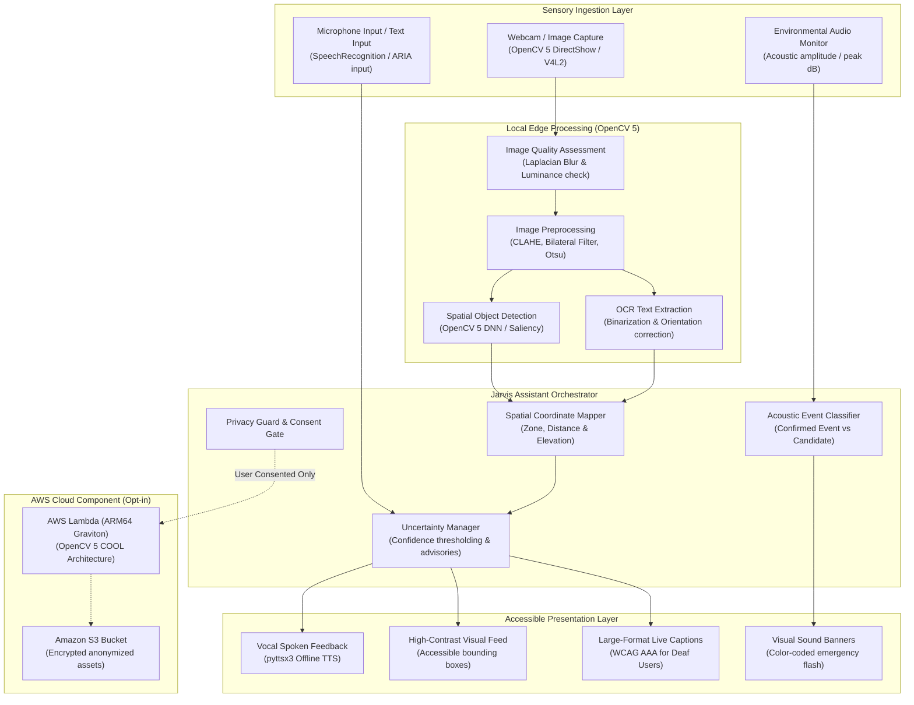

# VisionBridge AI — System Architecture Document
**OpenCV AI Competition 2026**

---

## 1. Executive Summary

**VisionBridge AI** is an intelligent, multimodal accessibility assistant inspired by Jarvis, purpose-built to assist blind, low-vision, deaf, and hard-of-hearing individuals. The system is engineered around a **local-first, privacy-preserving paradigm** powered by **OpenCV 5**, coupled with an opt-in **AWS Graviton-powered cloud component** utilizing the Cloud Optimized OpenCV Library (COOL).

---

## 2. High-Level System Architecture

The following diagram illustrates the end-to-end modular pipeline, from sensory ingestion to accessible multi-sensory presentation:

---

## 3. Modular Component Specification

### 3.1. Camera Manager (`src/camera.py`)
- **OpenCV 5 VideoCapture**: Direct hardware acquisition with DirectShow backend on Windows.
- **Resolution Standardization**: Normalizes all incoming frames to $640 \times 480$ pixels at 30 FPS.
- **Synthetic Frame Fallback**: Ensures full functional testability and headless server continuous integration without hardware camera dependencies.

### 3.2. Vision Pipeline (`src/vision.py`)
- **Image Quality Assessment (IQA)**:
  - **Blur Detection**: Variance of Laplacian ($\sigma^2_{Laplacian}$). If $<80$, triggers a spoken steadying advisory.
  - **Luminance Assessment**: Evaluates mean grayscale illumination. Values $<50$ trigger low-light guidance.
- **Adaptive Contrast Enhancement**: Employs CLAHE (Contrast Limited Adaptive Histogram Equalization) with a clip limit of $2.5$ on the luminance ($L$) channel of the CIELAB color space.
- **Spatial Coordinate Mapping**: Maps 2D bounding boxes $(x, y, w, h)$ to 5 horizontal zones (*far left, left, directly ahead, right, far right*) and 3 proximity tiers based on normalized bounding box height.

### 3.3. Object Detection & Scene Synthesis (`src/object_detection.py`)
- **OpenCV 5 DNN Architecture**: Supports ONNX and Caffe runtimes with standard 80-class COCO labels.
- **Contour Saliency Fallback**: Implements morphological gradient and aspect-ratio heuristics to guarantee instant detection out-of-the-box.
- **Conversational Jarvis Scene Describer**: Generates natural spoken descriptions emphasizing relative locations.
- **Mandatory Safety Disclaimer**: Strictly attaches navigational notices emphasizing that 2D object detection cannot guarantee obstacle-free navigation.

### 3.4. OCR & Reading Engine (`src/ocr.py`)
- **Bilateral Filtering**: Suppresses sensor noise while preserving character edges.
- **Orientation Correction (Deskew)**: Evaluates bounding box skew via `cv2.minAreaRect` and applies affine rotation.
- **CER & WER Metrics**: Built-in Levenshtein distance evaluators for Character Error Rate and Word Error Rate.

### 3.5. Audio & Accessibility Manager (`src/speech_to_text.py` & `src/text_to_speech.py`)
- **Offline TTS**: Local pyttsx3 speech synthesis eliminating cloud network dependencies and zero data leakage.
- **Acoustic Event Delineation**: Strictly differentiates **Confirmed Events** ($\ge 75 \text{ dB}$) from **Unconfirmed Sound Candidates** ($< 75 \text{ dB}$) with high-visibility color-coded alerts.
- **Large-Text Live Captions**: High-contrast dark theme ($#0B0F19$ background, $#00D2FF$ accent) conforming to WCAG 2.2 AAA.

### 3.6. AWS Cloud Component (`src/aws_service.py` & `deploy/`)
- **AWS Graviton4 / ARM64 Lambda**: Cloud Optimized OpenCV Library (COOL) execution for high-throughput frame processing.
- **Amazon S3**: Encrypted bucket for benchmark reports and model assets.
- **Privacy Enforcement**: Hard-coded gatekeeper `PrivacyConsentError` blocking any cloud transmission unless `user_consented == True`.
